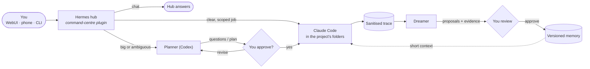

<p align="center">
  
</p>

<h1 align="center">Tabbie</h1>

<p align="center">
  <b>Your coding agents, one inbox.</b> Type a request on your Mac or phone; Tabbie sends it to the
  right agent, in the right repos, and remembers what worked.
</p>

<p align="center">
  
</p>

---

A personal command centre for coding agents on your Mac. You type a request in a web app (desktop
or phone) and Tabbie routes it:

- **Small, clear jobs** go straight to **Claude Code**, running in the right project folder.
- **Big or ambiguous jobs** go to a **planner** first (Codex, "Astra"). It asks the questions that
  matter, you approve the plan, and Claude Code carries it out.
- **Chat** stays with the hub model.

Use **Claude Code only, Codex only, or both**. `bin/setup` asks which, and you can switch any time in
the WebUI (see [Choosing Claude Code, Codex or both](#choosing-claude-code-codex-or-both)).

On top of that:

- **Projects** group several repos (site + app + API), each with its own instructions, memory and sessions.
- **Memory** is versioned and scoped, and agents only ever *propose* changes to it.
- **The Dreamer** reads past sessions and suggests lessons, backed by evidence, for you to approve.
- **Live agent cards** show what every worker and subagent is doing.
- **Attachments** are passed byte-exact.
- **Usage limits** are shown for every subscription.
- **Takeover**: when Claude hits its limit, the planner can continue the job.

Tabbie is built on two open-source projects and runs entirely on your machine:

- [Hermes Agent](https://github.com/NousResearch/hermes-agent): the hub agent, plugins and CLI.
- [Hermes WebUI](https://github.com/nesquena/hermes-webui): the web app. Tabbie adds an extension to it.

**No API keys.** Every provider signs in with its own subscription login (OAuth). Workers strip
`ANTHROPIC_API_KEY` / `OPENAI_API_KEY` from their environment and refuse to fall back to
pay-per-token billing.

---

## How it works



1. Every message passes through the `command-centre` plugin. It scores the request
   (deterministic regex signals, no LLM call), creates a request record on disk, ingests
   attachments and tells the hub which worker to call.
2. Workers read your **verbatim** prompt and the original files from disk, never a paraphrase.
3. After each request a sanitised trace is saved (secrets scrubbed). The Dreamer learns from these
   traces, and nothing becomes memory until you approve it.

---

## Requirements

- **macOS** (Apple silicon or Intel). The core runs anywhere Python does; the always-on services
  use launchd and Bonjour.
- **Python 3.11+**, **git**, **[uv](https://docs.astral.sh/uv/)**
- **[Hermes Agent](https://github.com/NousResearch/hermes-agent)**: provides `hermes`
- **At least one coding agent** (you pick at setup):
  - **[Claude Code](https://docs.anthropic.com/en/docs/claude-code)** with a Claude subscription: provides `claude`;
  - **[Codex CLI](https://github.com/openai/codex)** with a ChatGPT subscription: provides `codex`.
- **Optional:**
  - [Caddy](https://caddyserver.com) (`brew install caddy`), for `https://hermes.local` on your network.

---

## Install

```bash
git clone <this repo> ~/hermes      # the path ~/hermes is required for now
cd ~/hermes
bin/setup                           # asks Claude Code / Codex / both, checks tools, writes local config
```

Skip the question with `bin/setup --agents claude`, `--agents codex` or `--agents claude,codex`.

`bin/setup` is safe to re-run. It:

- saves your agent choice to `config/agents.yaml` (git-ignored) and only checks for the CLIs you picked;
- creates `state/`, `general/` and `workspaces/` (all git-ignored);
- copies `config/projects.example.yaml` → `config/projects.yaml`;
- writes `webui-extension/local.js` (your home folder and first name, git-ignored);
- clones the upstream WebUI into `hermes-webui/` and writes its `.env` from
  `config/webui.env.example`;
- appends the hub rules (`config/SOUL.hub.md`) to `~/.hermes/SOUL.md`;
- creates the memory store `memory/`, which is its own private git repo and is never pushed here;
- symlinks the four plugins into `~/.hermes/plugins/`.

### Sign in (once per provider)

| Provider | Needed for | Command |
|---|---|---|
| Hermes hub model | the dispatcher | `hermes setup` (pick any provider Hermes supports; e.g. `hermes auth add openai-codex --type oauth`) |
| Claude Code (if enabled) | executing work | `claude auth login` (must show `claude.ai` in `claude auth status`) |
| Codex (if enabled) | planner, takeover, or executing work in a Codex-only setup | `codex login` |
| Higgsfield (optional) | image/video generation | `higgsfield auth login` |
| ElevenLabs (optional) | voice/audio | add the hosted MCP below, then `hermes mcp login elevenlabs` |

### Hermes config (`~/.hermes/config.yaml`)

Workers can run for a long time, so raise the tool timeout:

```yaml
timeouts:
  tools:
    sequential_call: 3900   # executor.timeout_seconds in config/router.yaml + margin
```

Optional ElevenLabs tools:

```yaml
mcp_servers:
  elevenlabs:
    url: "https://api.us.elevenlabs.io/v1/mcp"
    auth: oauth
```

### WebUI password

Edit `hermes-webui/.env` and set `HERMES_WEBUI_PASSWORD=…`. The file is git-ignored and `chmod 600`.
Keep the WebUI behind this password: it can start agents on your Mac.

### Start the services

```bash
bin/setup --services      # installs + starts the LaunchAgents
bin/hub health            # one line per component, with the fix command
```

| LaunchAgent | What |
|---|---|
| `ai.hermes.gateway` | Hermes gateway (installed by `hermes gateway install`) |
| `ai.hermes.webui` | WebUI on `127.0.0.1:8787` |
| `ai.hermes.caddy` | HTTPS for `hermes.local`; LAN and Tailscale addresses only, everything else is dropped |
| `ai.hermes.mdns` | Bonjour name `hermes.local` → your Mac's LAN IP |
| `ai.hermes.cc-sidecar` | Data sidecar for the WebUI extension on `127.0.0.1:8794` (token-protected) |
| `ai.hermes.dreamer` | Nightly Dreamer run (03:30, low priority) |

The templates live in `services/*.plist.template`. Nothing is exposed to the internet. Without
Caddy, open `http://127.0.0.1:8787` on the Mac itself.

**Trust the local HTTPS certificate** (once per device). It enables passkeys and the installable app:

- Mac: open Keychain Access and trust Caddy's local CA.
- iPhone:
  1. Open `http://hermes.local/hermes-ca.crt` and install the profile.
  2. Go to Settings › General › About › Certificate Trust Settings and turn on full trust for it.

Open the app with `bin/hub` (or go to `https://hermes.local`).

---

## Using it

### Routing

| Route | When | Flow |
|---|---|---|
| **Hub** | General chat with no project selected | The hub answers directly |
| **Claude** (default) | Clear, scoped work: "fix this error", "run the tests", "make the button black" | Claude Code runs in the project; follow-ups resume the same Claude session (≤ 2 h) |
| **Planner → approval → Claude** | Broad or ambiguous work: features, migrations, architecture, several deliverables | The planner asks material questions or proposes a plan. You approve, it writes a brief, and Claude executes with the brief, your original prompt and the original attachments |

- Message prefixes:
  - `@claude …` runs Claude now.
  - `@astra …` / `@plan …` goes through the planner.
  - `@project:<name> …` picks the project.
- Approval replies:
  - `yes` / `go` approves;
  - `yes but …` approves with changes;
  - anything else revises;
  - `cancel` drops the request.
- Execution of a planned request is refused in code unless it was approved.
- Every reply starts with `Route: …`. The full decision log is at `bin/hub logs decisions`.

### Projects

A **Project** groups the folders or repos that make up one product. Nothing becomes a project
automatically. In the WebUI, open the rail → **Projects** → **New project**:

1. Name it and add folders. Pick from suggested repos, browse, or type a path, and select several at once.
2. Choose the primary folder; workers start there and get the others as extra directories.
3. **New task** opens a session that knows the project. Workers get a short context block, never memory dumps.

The project home has tabs for:

- folders, sessions and memory (search it, or delete entries);
- the Dreamer (findings with evidence; approve or reject proposals with a diff);
- skills, instructions, architecture and settings.

<p align="center">
  
</p>

Folder access is limited to linked folders under your home folder. It never includes hidden folders
(`~/.ssh`…), personal folders (Documents, Desktop…) or Tabbie's own state.

For lighter routing, `config/projects.yaml` names folders the router can target, and
`/cc workspace create <name> <folders…>` makes a multi-folder workspace.

### Memory and the Dreamer

- `memory/` is a separate git repo:
  - Markdown memories with provenance, scoped `global/`, `projects/<id>/` or `agents/<a>/`;
  - every write is locked, hash-checked and committed.
- **Only you change memory.**
  - Workers can't edit it.
  - They file proposals (`hmem propose …`), which you approve in the WebUI or with `hmem approve <id>`.
  - Content from web pages or tools stays marked `external` and is never injected into a prompt as fact.
- **The Dreamer** (`hmem dream`, nightly, or after N sessions) looks for repeated failures and the
  rules you stated across several conversations. It files a few proposals, each with evidence. In a
  project it only reads that project's sessions.
- CLI reference: `hmem search|read|proposals|show|approve|reject|history|rollback|stats|doctor`, and
  `hmem project …`.

<p align="center">
  
</p>

Design notes: `docs/memory/ARCHITECTURE.md`, `docs/projects/ARCHITECTURE.md`.

### Attachments, agents, questions, takeover

- **Attachments** (uploads, `@file:` refs, pasted paths):
  - stored byte-exact and read-only under `state/requests/<id>/attachments/`;
  - a manifest records each file's name, type, size and sha256;
  - derived files (extracted ZIPs, PDF text, media info) sit beside the originals.
- **Agents panel**: each reply shows a live block of the worker and its subagents (status, latest
  step, tokens, time). The Agents pill opens the whole session.
- **Questions**: when a worker needs a decision it asks a structured question card, and your reply
  resumes the same session.
- **Takeover**: if Claude hits its usage limit, Tabbie offers to let the planner continue from where
  it stopped. `/takeover` toggles it.
- **Limits**: `/limit` or `bin/hub limits` shows % used and reset times for each signed-in subscription.

### Choosing Claude Code, Codex or both

| Setup | Who executes | Who plans big jobs | Usage limit hit |
|---|---|---|---|
| **Both** (default) | Claude Code, or Codex if you pick an OpenAI model for the chat | Codex ("Astra") | Codex can take over (`/takeover`) |
| **Claude Code only** | Claude Code | Claude Code (`claude-cli` planner) | Tabbie tells you; no takeover |
| **Codex only** | Codex | Codex | no fallback agent |

Change it any time from the composer's **model picker → Agents** (Claude Code / Codex toggles; at
least one stays on). It applies on the next request with no restart. It's stored in
`config/agents.yaml`:

```yaml
enabled: [claude, codex]   # or [claude], or [codex]
```

With one agent off, its models disappear from the picker, the planner switches to the agent you
have, `/limit` and `bin/hub health` skip it, and chat titles and Dreamer phrasing (which use Claude
Haiku) fall back to plain text when Claude Code is off. No file means both (older installs).

### Optional: motion studio

`/motion <brief>` runs Claude in `~/motion` (a Remotion project of your own) with a `motion` skill.
The motion panel in the WebUI expects that folder. Ignore this if you don't use it.

---

## Configuration

| File | What | Tracked? |
|---|---|---|
| `config/router.yaml` | Router, planner and executor settings, memory and Dreamer options. Re-read on every request | yes (defaults) |
| `config/agents.yaml` | Which coding agents to use: Claude Code, Codex or both | no (written by `bin/setup` / the WebUI) |
| `config/projects.yaml` | Named folders and workspaces for routing | no (from `.example`) |
| `hermes-webui/.env` | WebUI host, port and password | no (from `config/webui.env.example`) |
| `webui-extension/local.js` | Your home path and name for the extension | no (from `local.example.js`) |
| `~/.hermes/config.yaml`, `~/.hermes/SOUL.md` | Hermes Agent's own config and hub rules | outside the repo |

To change the planner, edit `config/router.yaml`; it applies on the next request.

```yaml
planner:
  provider: codex-cli      # or claude-cli (used automatically when Codex is off)
  model: <a model your login exposes>   # list them with: /cc planner
```

If the model isn't available to your login, planning fails with a clear error and never swaps in
another model. Auto-approval of Dreamer proposals is off (`memory.auto_approve`); it never covers
global memory, skills or deletions.

---

## Security model

- **No secrets in the repo.** `.gitignore` excludes `.env*`, token, credential and key files,
  `memory/`, `state/` and all per-machine config. Provider logins live in each tool's own store
  (Keychain, `~/.claude`, `~/.codex`, `~/.hermes`).
- **Traces are scrubbed.** Keys, tokens, passwords and URL credentials are removed before anything
  is written to disk.
- **The WebUI is the only door.** It is password-protected and listens on localhost; Caddy exposes
  it to your LAN and Tailscale only. The extension's sidecar needs a token minted by the WebUI
  after a one-time consent.
- **Workers can't rewrite memory or approve anything.** Their file tools are denied on `memory/`
  and the sidecar token. User-only `hmem` commands refuse to run inside a worker. Memory files
  edited outside the store are ignored until you review them (`hmem doctor`).
- **Untrusted text stays data.** Repo files, web pages and tool output can't become standing
  instructions: they are scanned for injection, kept `external`, and must be approved by you.

Defence in depth, not a sandbox: a worker runs as your user with Claude Code's permission mode.
Use Claude Code's own permission settings for hard limits.

---

## Repo layout

| Path | What |
|---|---|
| `plugin/command-centre/` | Router plugin: `router.py` scoring, `attachments.py`, `state.py` request lifecycle, `providers.py` Claude/planner runners and auth checks, `projects.py`, `agents.py`, `questions.py`, `sidecar.py` |
| `plugin/fragment-memory/` | Hub memory tools (`mem_save/search/read/forget`) |
| `plugin/limits/` | `/limit` usage view |
| `plugin/workboard/` | Kanban cards and todos shared with the WebUI |
| `hmem/`, `bin/hmem` | Memory store, tracer, Dreamer, Projects registry, CLI, HTTP API |
| `webui-extension/` | WebUI extension: Apple-style skin, Projects, agents, questions, limits, workboard, motion studio |
| `brand/` | Icons, mascot animation frames, login skin |
| `services/` | LaunchAgent templates and the Caddyfile |
| `bin/` | `setup`, `hub` (open, cli, health, restart, logs, import, limits), service entrypoints |
| `config/` | Router defaults and the `*.example` files |
| `docs/` | Architecture notes |
| `tests/` | Test suite |

## Tests

```bash
uv run -q --no-project --with pytest --with ruamel.yaml python -m pytest tests -q
```

The tests use temporary folders only and never touch your memory or state.

## Troubleshooting

- `bin/hub health` checks every component and prints the fix command.
- `bin/hub logs webui|gateway|caddy|mdns|decisions` shows logs.
- **Page hangs in a Mac browser**: System Settings › Privacy & Security › Local Network → allow the browser.
- **Wrong route**: `/cc route <text>` shows the score. Tune the signals in `router.py` or `router.plan_threshold`.
- **Claude refuses to run**: `claude auth status` must show a `claude.ai` login. API keys are refused on purpose.
- **Planner errors**: `/cc planner` lists the models your login exposes.
- **Restart everything**: `bin/hub restart`. Don't restart while a request is running.

## License

MIT. See `LICENSE`.
