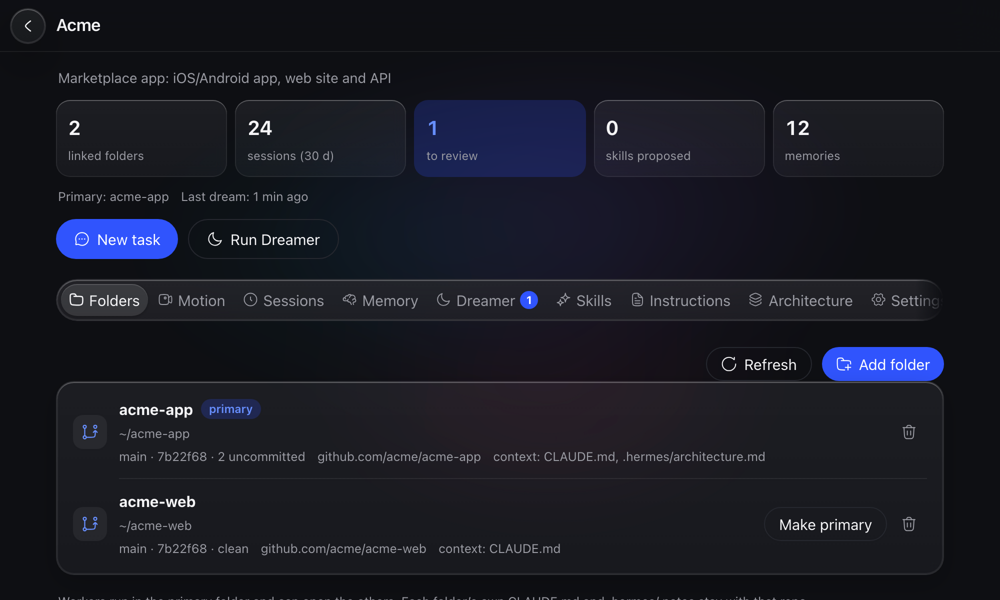
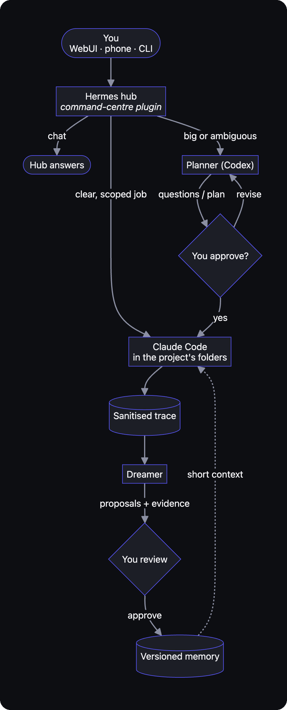
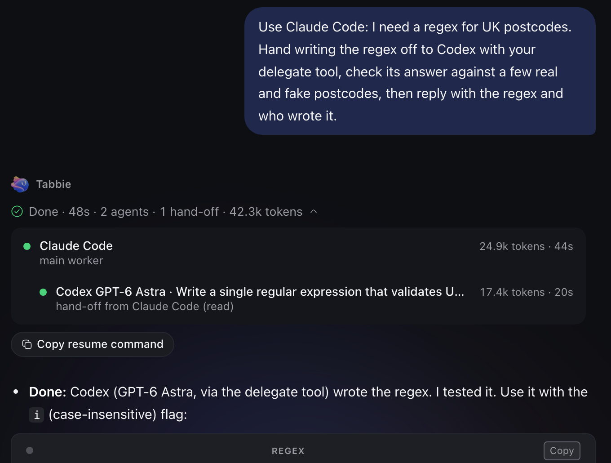
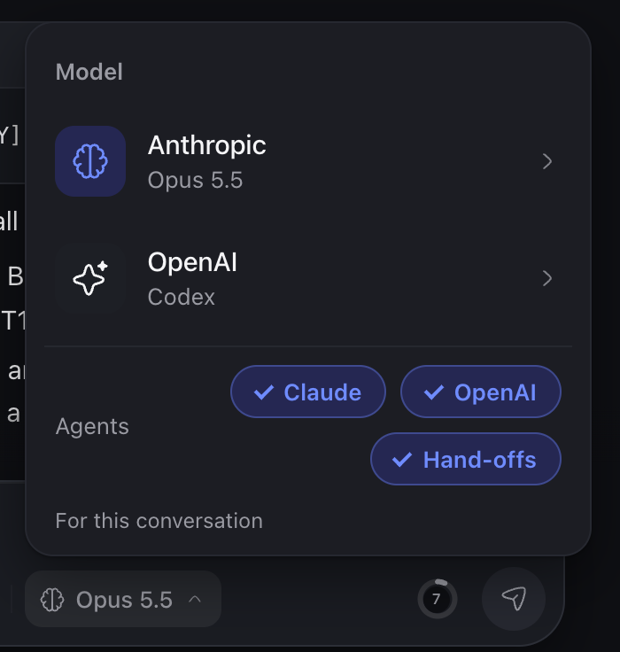
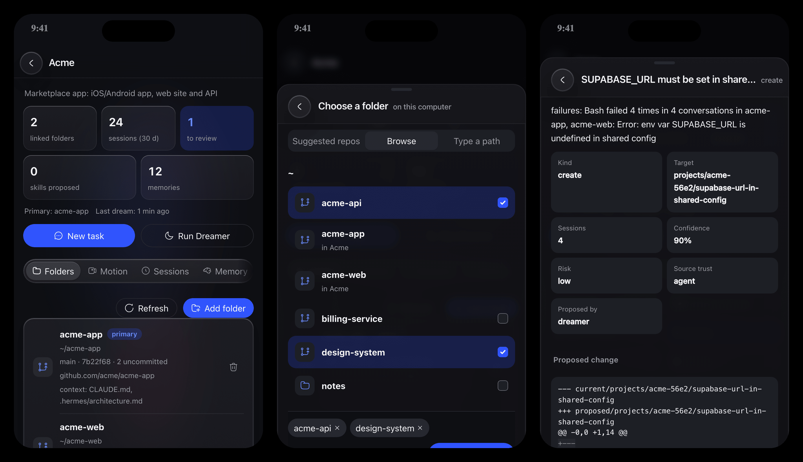
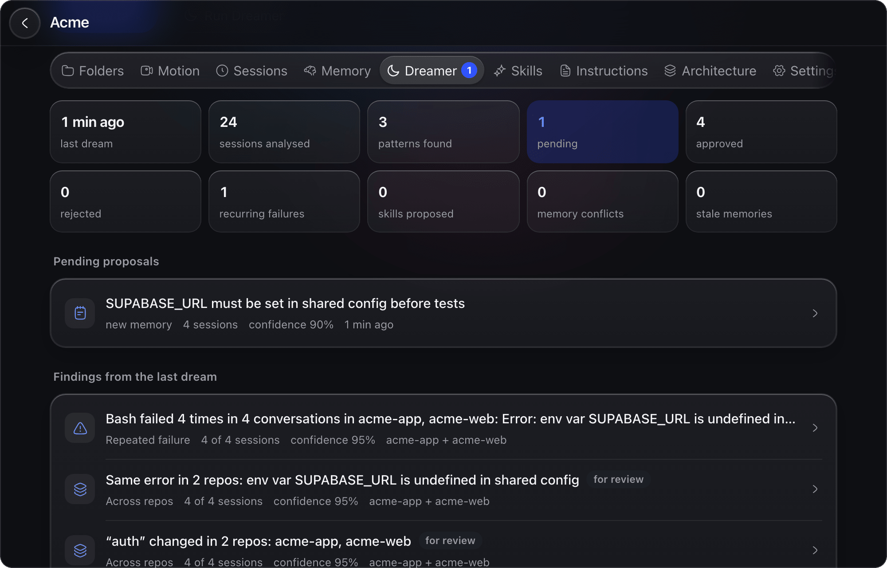

<p align="center">
  
</p>

<h1 align="center">Tabbie</h1>

<p align="center">
  <b>Your coding agents, one inbox.</b> Type a request on your Mac or phone; Tabbie sends it to the
  right agent, in the right repos, and remembers what worked.
</p>

<p align="center">
  
</p>

> **Having an AI agent install this?** Tell it: *"Install Tabbie by following the
> [Installing with a coding agent](#installing-with-a-coding-agent-codex-claude-code-) section of
> the README exactly."*

---

A personal command centre for coding agents on your Mac. You type a request in a web app (desktop
or phone) and Tabbie routes it:

- **Small, clear jobs** go straight to **Claude Code**, running in the right project folder.
- **Big or ambiguous jobs** go to a **planner** first (Codex, "Astra"). It asks the questions that
  matter, you approve the plan, and Claude Code carries it out.
- **Chat** stays with the hub model.

Use **Claude Code only, Codex only, or both**. `bin/setup` asks which, and you can switch any time in
the WebUI (see [Choosing Claude Code, Codex or both](#choosing-claude-code-codex-or-both)).

On top of that:

- **Projects** group several repos (site + app + API), each with its own instructions, memory and sessions.
- **Memory** is versioned and scoped, and agents only ever *propose* changes to it.
- **The Dreamer** reads past sessions and suggests lessons, backed by evidence, for you to approve.
- **Live agent cards** show what every worker and subagent is doing.
- **Attachments** are passed byte-exact.
- **Usage limits** are shown for every subscription.
- **Takeover**: when Claude hits its limit, the planner can continue the job.
- **Hand-offs**: with both agents linked, Claude can pass a task to Codex (or Codex to Claude), or
  to its own subagents, when it judges that's better. On by default.
- **Fast and lean**: workers start with a slim profile and the reply is relayed verbatim, so a small
  job finishes in about 10–15 s.

Tabbie is built on two open-source projects and runs entirely on your machine:

- [Hermes Agent](https://github.com/NousResearch/hermes-agent): the hub agent, plugins and CLI.
- [Hermes WebUI](https://github.com/nesquena/hermes-webui): the web app. Tabbie adds an extension to it.

**No API keys.** Every provider signs in with its own subscription login (OAuth). Workers strip
`ANTHROPIC_API_KEY` / `OPENAI_API_KEY` from their environment and refuse to fall back to
pay-per-token billing.

---

## How it works

<p align="center">
  
</p>

1. Every message passes through the `command-centre` plugin. It scores the request
   (deterministic regex signals, no LLM call), creates a request record on disk, ingests
   attachments and tells the hub which worker to call.
2. Workers read your **verbatim** prompt and the original files from disk, never a paraphrase.
3. After each request a sanitised trace is saved (secrets scrubbed). The Dreamer learns from these
   traces and applies what it learns on its own (never skills or anything from untrusted content).

### Speed and tokens

Each request passes through the hub, a worker and back. To cut both time and tokens:

- **Lean workers** (`executor.worker_profile: lean`): Claude Code starts with project settings only and no
  stray MCP servers, but keeps your user skills and the plugins in `plugins_keep` (the design
  plugins by default). `worker_profile: full` loads everything, as before.
- **Early start**: a clear request starts its worker while the hub is still replying.
- **Per-chat sessions**: a follow-up in the same chat continues that chat's Claude session
  (`resume_max_age_minutes`); once it passes `resume_max_context` (120k tokens) the next one starts
  fresh with the last few turns instead of re-reading the whole history.
- **Verbatim relay** (`relay: verbatim`): the worker's answer is passed through as-is, instead of
  the hub model re-typing it. `relay: hub` lets the hub rewrite it, as before.
- **Planner finalize skip** (`planner.finalize: auto`): an approved plan goes straight to Claude
  when the brief is already complete.

Measured with `bin/bench-latency` (two passes of 3 runs each, Opus 5.5):

| Request | Time |
|---|---|
| Overhead around a job (R1: `sleep 45`, minus the 45 s) | 10–13 s (was 28–42 s) |
| Small real job (R2: count files) | 9–14 s |
| Long answer (R3: explain a file) | 11–17 s |
| Worker's first call | about 21k tokens, half cached (was 35–48k) |

`bin/bench-latency --label NAME [--runs 3] [--only R1,R2]` runs it again; results go to `state/bench/`.

### Hand-offs (dynamic agents)

With **both** Claude Code and Codex linked, each worker gets a `delegate` tool and uses its own
judgement: do the job alone, use its own subagents, or hand a self-contained piece to the other
agent with the context it needs (Claude → Codex for some tasks, Codex → Claude for others). A
hand-off shows as a nested row in the reply's Agents block (e.g. "hand-off from Claude Code").
Hand-offs go one level deep; the helper can't hand off again.

<p align="center">
  
  
</p>

On by default. Turn it off with the **Hand-offs** pill in the model picker's Agents row, or
`dynamic: false` in `config/agents.yaml`. With one agent off, there is nothing to hand off to.

### Usage limits gate

Before any worker, planner or hand-off starts, Tabbie checks the subscription's usage (cached for
60 s). At 95% or more the request runs on the other agent's equivalent model instead, and the reply's
route line says so (Opus 5.5 ↔ GPT-6.1 Sol, Fable 5.1 ↔ GPT-6-Astra, Sonnet 5.5 ↔ GPT-6.1 Terra,
Haiku 5.5 ↔ GPT-6 Luna; the same pairs are used for hand-offs and when an agent is switched off). If the
other agent is also at its limit or not signed in, nothing starts and Tabbie says when the limit resets.
If Claude can't sign in (logged out, expired token), the job also goes to its GPT equivalent.
A planner at its limit falls back to the other planner. Hand-offs to Codex stop at 90%, so they
never use up the ChatGPT allowance the hub shares. If usage can't be read, it starts anyway (logged). `bin/limit-gate` runs the same check (it's also used as a hook).

---

## Requirements

- **macOS** on Apple silicon or Intel. No Homebrew needed. The core runs anywhere Python does; the
  always-on services use launchd and Bonjour.
- **git** and **Python 3** (Apple's free developer tools; setup offers to install them)
- **[Hermes Agent](https://github.com/NousResearch/hermes-agent)**: the hub (`hermes`)
- **At least one coding agent** (you pick at setup):
  - **[Claude Code](https://docs.anthropic.com/en/docs/claude-code)** with a Claude subscription: provides `claude`;
  - **[Codex CLI](https://github.com/openai/codex)** with a ChatGPT subscription: provides `codex`.
- **[Caddy](https://caddyserver.com)**: **required.** Tabbie is always opened through Caddy at
  `https://hermes.local`. Caddy serves Tabbie's icons, page addresses (`/kanban`, `/projects` …),
  the Motion studio and phone access. Without it you get the plain Hermes WebUI on port 8787, with
  the wrong icons and missing pages. Setup installs it (`bin/install-tool caddy`); no Homebrew.
- **[uv](https://docs.astral.sh/uv/)**: **required.** Runs Tabbie's helper service (the agents panel, Stop,
  Hand-offs, Motion and updates) with the Python packages it needs, and the tests. Setup installs it
  (`bin/install-tool uv`).
- [Node.js](https://nodejs.org) only for the Motion studio (Remotion renders with it; `bin/install-tool node`)

Setup installs all of these for you.

### Installing with a coding agent (Codex, Claude Code …)

Asking Claude Code, Codex or another agent to install Tabbie? Point it at this section. It's a
runbook, written for the agent.

> **Agent: follow these steps in order. Don't skip, reorder or improvise.**
> The user has to be at the Mac for the steps marked 👤: the WebUI password and the account sign-ins
> must come from them. Never invent, type or store a password, API key or token for them.

#### Step 0: Ask the user these questions first, all in one message

1. "What's your first name?" (used only for the greeting on the chat home)
2. "Which coding agents do you pay for: **Claude** (Claude Code, Claude subscription), **OpenAI**
   (Codex, ChatGPT subscription), or **both**?" Gives `--agents claude`, `codex` or `claude,codex`.
3. Only if both: "Should the hub (the chat that routes your requests) use your **ChatGPT** login or
   your **Claude** login?" Gives `--hub openai-codex` or `--hub anthropic`. With one agent, use the
   matching hub (`claude` → `anthropic`, `codex` → `openai-codex`).
4. "Do you want to use Tabbie from your phone **away from home** (mobile data, work)? That needs
   **Tailscale**, a free private network between your own devices." (yes / no / later)
5. "Do you want the **Motion studio** (makes product films; installs Node.js, about 300 MB)?" (yes / no)
6. "Do you have **Higgsfield** (image/video generation) or **ElevenLabs** (voice/music) accounts to
   link? Both are optional." (Motion greys out their buttons when they aren't linked.)

#### Step 1: Clone and run the unattended parts (agent)

```bash
git clone https://github.com/aaronyaml/Tabbie.git ~/hermes   # must be exactly ~/hermes
cd ~/hermes
bin/setup --yes --name "<first name>" --agents <claude|codex|claude,codex> --hub <anthropic|openai-codex> \
  --only name,agents,tools,files,motion     # leave out ",motion" if they said no to Motion
```

This installs Hermes Agent, Claude Code and/or Codex, and Caddy (official builds, no Homebrew, no
Mac password). It also writes the local files and enables the plugins. Sign-ins, the password and
phone setup are left for the user. On a brand-new Mac, macOS first asks to install Apple's developer
tools (git, Python): tell the user to click **Install** and wait, then run the command again.
They can add Motion later with `bin/setup --yes --only motion`.

#### Step 2: 👤 The user finishes setup in the Terminal app

Agents can't type the password or do browser logins. Tell the user, word for word if it helps:

> Open the **Terminal** app on your Mac and paste:
> `cd ~/hermes && bin/setup`
> A setup page opens in your browser. Press each step's button. When it asks, sign in to your
> ChatGPT / Claude accounts and choose a WebUI password. Tell me when the last step shows ✓.

(No browser available, or the user prefers the Terminal: `cd ~/hermes && bin/setup --terminal`.)

This does, with the user present: the account sign-ins, the WebUI password, the background services,
the `https://hermes.local` certificate, and the phone step. Wait until they say it's done.

#### Step 3: 👤 Tailscale, only if they answered yes in Step 0

The phone step of `bin/setup` walks through it. If they skipped it, guide them step by step,
waiting for an answer after each:

1. "Install **Tailscale** from the Mac App Store, open it, and log in (Google, Apple or Microsoft
   account). Tell me when the menu-bar icon says Connected." Then check:
   `/Applications/Tailscale.app/Contents/MacOS/Tailscale status` (or `tailscale status`).
2. "Open <https://login.tailscale.com/admin/dns>, turn on **MagicDNS**, then under
   **HTTPS Certificates** click **Enable HTTPS**. Tell me when done."
3. Agent runs: `/Applications/Tailscale.app/Contents/MacOS/Tailscale serve --bg 8788`
   (`tailscale serve --bg 8788` for a Homebrew install). Port 8788 is Caddy, never 8787.
   Use `serve` only. **Never use `tailscale funnel`**: that would put Tabbie on the public internet.
4. Get the address: `… Tailscale status --json` → `Self.DNSName` (drop the trailing dot), giving
   `https://<mac-name>.<tailnet>.ts.net`.
5. "On your phone, install **Tailscale** (App Store / Google Play), log in with the **same
   account**, allow the VPN, turn it on, then open `<that address>` and log in with your WebUI
   password. Add it to your home screen from the Share menu."

#### Step 4: Optional accounts (only the ones they said yes to in Step 0)

- Higgsfield: the user runs `higgsfield auth login` in the Terminal (browser login).
- ElevenLabs: see [Sign in](#sign-in-once-per-provider). The user signs in themselves.

#### Step 5: Check (agent)

```bash
cd ~/hermes && bin/hub health
```

Every line must be ✓, except lines marked *optional*. Each ✗ line prints its fix command: run it
(or, if it needs the user, ask them), then run `bin/hub health` again. Done when it's all ✓.

Then tell the user:

> Open **https://hermes.local** (or run `bin/hub`) and log in with your WebUI password. When an
> **Allow Tabbie's helper** card appears bottom-right, press **Allow**. Updates show up as a card
> in the page, and in Settings → System.

#### Rules for agents (don't break these)

- **Path:** always `~/hermes`.
- **Caddy is required.** Tabbie is only ever opened through `https://hermes.local` (or the
  Tailscale address). "The WebUI loads on `http://127.0.0.1:8787`" is **not** a working install:
  that's the bare upstream WebUI, with the wrong icons and missing pages. If `command -v caddy`
  fails: `bin/install-tool caddy`, then `bin/setup --terminal --only services,cert --services`
  (the WebUI password must already be set).
- **The four plugins must be enabled**, not just linked: `command-centre`, `fragment-memory`,
  `limits`, `workboard` (`hermes plugins enable <name> --no-allow-tool-override`). Without them
  the hub answers everything itself and ignores the model picker, Claude Code and Codex.
- **Subscription logins only.** Never create, ask for or paste an API key. Never print or log
  passwords or tokens.
- **Don't hand-install pieces** or edit `~/.hermes/config.yaml` yourself. `bin/setup` backs up the
  config and is safe to re-run: done steps are skipped.
- **Never expose Tabbie publicly.** No port forwarding, no `tailscale funnel`, no binding 8787 or
  8788 to `0.0.0.0`. The WebUI password always stays on.
- **Don't restart services while a request is running** (`bin/hub health` / the WebUI shows it).
- **Every background service must be running, including Tabbie's helper (`ai.hermes.cc-sidecar`).**
  `bin/hub health` has a line for it. If it's ✗: `bin/hub services` installs any service that's
  missing (safe any time; running ones are left alone), then `bin/hub health` again. Without the
  helper the WebUI says it can't reach Tabbie on the Mac: no agents panel, Stop, Hand-offs pill,
  Motion or updates.

---

## Install

Open the **Terminal** app and paste:

```bash
git clone https://github.com/aaronyaml/Tabbie.git ~/hermes   # the path ~/hermes is required for now
cd ~/hermes
bin/setup
```

`bin/setup` opens **Tabbie's setup page in your browser**. It's served only to this Mac, behind a
one-time link. Each step has a button, nothing is installed or changed until you press it, and
the first run takes about 10 minutes. On a brand-new Mac it first asks to install Apple's free
developer tools (git and Python). Leave the Terminal window open until the page says you're done.

| Step | What happens |
|---|---|
| 1. About you | Your first name, for the greeting on the chat home ("Morning, Sam", "Afternoon, Sam", "Evening, Sam") |
| 2. Coding agents | **Claude only**, **OpenAI only**, or **Claude and OpenAI** ([what each means](#choosing-claude-code-codex-or-both)) |
| 3. Tools | Installs Hermes Agent, Claude Code and/or Codex, and Caddy from their official sources, with the right build for Apple silicon or Intel. No Homebrew and no Mac password |
| 4. Sign in | Opens each provider's own login in your browser: the hub (ChatGPT or Claude login, your choice when you use both), Claude Code, Codex. No API keys. The WebUI's own first-run wizard, which asks for API keys, is switched off |
| 5. Local files | Folders, settings, the WebUI, the private memory store, plugins, and the hub's worker timeout (your Hermes config is backed up first) |
| 6. WebUI password | Asks for a password (hidden as you type) and saves it where only you can read it |
| 7. Background services | Installs and starts the services so Tabbie runs whenever your Mac is on |
| 8. Secure address | Sets up `https://hermes.local` and offers to trust its certificate on this Mac |
| 9. Motion studio | Optional. Installs Node.js (official build, Apple silicon or Intel) and creates the Motion studio from Tabbie's template, with its packages ([details](#motion-studio)) |
| 10. Your phone | Home Wi-Fi instructions, and optionally Tailscale for anywhere ([details](#use-tabbie-on-your-phone-anywhere-tailscale)) |
| 11. Check | Runs `bin/hub health` and shows the address to open |

It's safe to run again any time: finished steps are ticked and skipped, and anything marked `!`
tells you exactly what to do. When services are already running it asks before restarting them.

The first time you open Tabbie, an **Allow Tabbie's helper** card appears bottom-right. Press
**Allow**: Projects, the model picker, Motion, sign-in and update checks talk to a small helper on
your Mac, and the WebUI asks once before letting them (also in Settings → Extensions).

Skipped the hub sign-in, or it got signed out? Tabbie notices and shows a **Finish setting up
Tabbie** card in the WebUI (also from your phone): **Sign in with ChatGPT** gives you a link and a
code to enter on any device; **Use my Claude login** uses Claude Code's login on the Mac, and can
start that sign-in on the Mac for you. Your Hermes config is backed up before the hub is pointed
at the new login.

Prefer the Terminal? `bin/setup --terminal` runs the same steps there. For scripted installs,
`bin/setup --yes` uses defaults and leaves sign-ins, the password and phone setup for later. Answer
some ahead of time with `--agents claude|codex|claude,codex`, `--name Sam`, `--hub openai-codex|anthropic`
and `--services`. A single tool can be installed with `bin/install-tool hermes|claude|codex|caddy|uv|node`.

Everything it writes on your Mac is git-ignored: `config/agents.yaml`, `config/projects.yaml`,
`webui-extension/local.js`, `hermes-webui/` and its `.env`, `state/`, `general/`, `workspaces/`, `motion/`, and
`memory/` (its own private git repo). It also appends the hub rules to `~/.hermes/SOUL.md` and
symlinks the four plugins into `~/.hermes/plugins/`.

The sections below explain each part in more detail, if you'd rather do things by hand.

### Sign in (once per provider)

| Provider | Needed for | Command |
|---|---|---|
| Hermes hub model | chat + routing | Your **ChatGPT** login (`hermes auth add openai-codex --type oauth`) or your **Claude** login (`hermes auth add anthropic --type oauth`). `bin/setup` picks the one matching your agents and asks when you have both. Never an API key |
| Claude Code (if enabled) | executing work | `claude auth login` (must show `claude.ai` in `claude auth status`) |
| Codex (if enabled) | planner, takeover, or executing work in a Codex-only setup | `codex login` |
| Higgsfield (optional) | image/video generation | `higgsfield auth login` |
| ElevenLabs (optional) | voice/audio | add the hosted MCP below, then `hermes mcp login elevenlabs`. Motion's music generation uses an API key instead ([Motion studio](#motion-studio)) |

### Hermes config (`~/.hermes/config.yaml`)

Workers can run for a long time, so raise the tool timeout:

```yaml
timeouts:
  tools:
    sequential_call: 3900   # executor.timeout_seconds in config/router.yaml + margin
```

Optional ElevenLabs tools:

```yaml
mcp_servers:
  elevenlabs:
    url: "https://api.us.elevenlabs.io/v1/mcp"
    auth: oauth
```

### WebUI password

Edit `hermes-webui/.env` and set `HERMES_WEBUI_PASSWORD=…`. The file is git-ignored and `chmod 600`.
Keep the WebUI behind this password: it can start agents on your Mac.

### Start the services

```bash
bin/setup --services      # installs + starts the LaunchAgents
bin/hub health            # one line per component, with the fix command
```

| LaunchAgent | What |
|---|---|
| `ai.hermes.gateway` | Hermes gateway (installed by `hermes gateway install`) |
| `ai.hermes.webui` | WebUI on `127.0.0.1:8787` |
| `ai.hermes.caddy` | HTTPS for `hermes.local`; LAN and Tailscale addresses only, everything else is dropped |
| `ai.hermes.mdns` | Bonjour name `hermes.local` → your Mac's LAN IP |
| `ai.hermes.cc-sidecar` | Tabbie's helper for the WebUI extension on `127.0.0.1:8794` (token-protected): agents panel, Stop, Hand-offs, Projects, Motion, updates. Runs through `uv` with PyYAML |
| `ai.hermes.dreamer` | Nightly Dreamer run (03:30, low priority) |

The templates live in `services/*.plist.template`. **New services install themselves:** when an update
adds one, Tabbie installs it the next time it starts (and `bin/hub update`, `bin/hub restart` and
`bin/setup` do too), so nobody has to re-run setup for it. `bin/hub services` does it by hand. A
service that's already running is never touched, except when an update changes its own template;
then it's reinstalled with the other restarts, once Tabbie is idle. Nothing is exposed to the internet. Always open Tabbie through
Caddy (`https://hermes.local`, or `bin/hub`): the bare WebUI on `127.0.0.1:8787` lacks Tabbie's icons and page addresses.

**Trust the local HTTPS certificate** (once per device). It enables passkeys and the installable app:

- Mac: open Keychain Access and trust Caddy's local CA.
- iPhone:
  1. Open `http://hermes.local/hermes-ca.crt` and install the profile.
  2. Go to Settings › General › About › Certificate Trust Settings and turn on full trust for it.

Open the app with `bin/hub` (or go to `https://hermes.local`).

### Use Tabbie on your phone, anywhere (Tailscale)

`https://hermes.local` only works when your phone is on the same Wi-Fi as your Mac. To reach
Tabbie from anywhere (mobile data, work, travelling) use **[Tailscale](https://tailscale.com)**.
It's a free, private network (a "VPN") between your own devices. Your Mac stays invisible to the
rest of the internet: only devices signed in to *your* Tailscale account can reach it.

You'll do this once. It takes about 10 minutes and needs no networking knowledge.

**What you need:** your Mac (with Tabbie running), your phone, and an email account to sign in
with (Google, Apple, Microsoft or GitHub).

#### Step 1: Create a Tailscale account

1. Go to [tailscale.com](https://tailscale.com) and click **Get started**.
2. Sign in with Google, Apple, Microsoft or GitHub. The personal plan is free.

Use this **same account** on every device below.

#### Step 2: Put Tailscale on your Mac

1. Install **Tailscale** from the [Mac App Store](https://apps.apple.com/app/tailscale/id1475387142)
   (or from [tailscale.com/download](https://tailscale.com/download)).
2. Open it. A small Tailscale icon appears in the menu bar at the top of the screen.
3. Click the icon and choose **Log in**. Sign in with the account from step 1.
4. If macOS asks to **allow a VPN configuration** or a **system extension**, click **Allow**.
   It may send you to System Settings › Privacy & Security to approve it.
5. The menu bar icon should now say **Connected**.

#### Step 3: Turn on secure links (once per account)

1. Open the [Tailscale admin console](https://login.tailscale.com/admin/dns) and go to the **DNS** tab.
2. Make sure **MagicDNS** is on.
3. Scroll to **HTTPS Certificates** and click **Enable HTTPS**.

This gives your Mac a private web address with a padlock, such as `https://my-mac.tail1234.ts.net`.

#### Step 4: Share Tabbie on your private network

Open the **Terminal** app on your Mac (press ⌘ Space, type *Terminal*, press Return). Paste this
line and press Return:

```bash
/Applications/Tailscale.app/Contents/MacOS/Tailscale serve --bg 8788
```

> Installed Tailscale with Homebrew instead of the app? The command is just `tailscale serve --bg 8788`.

It prints your Tabbie address, ending in `.ts.net`. **Write it down** (or copy it into a note on
your phone). You only do this once: it keeps working after restarts.

> ⚠️ Use `serve`, **never** `funnel`. *Funnel* puts your Mac on the public internet. *Serve* keeps it
> private to your own devices.

#### Step 5: Put Tailscale on your phone

**iPhone / iPad**

1. Install **Tailscale** from the [App Store](https://apps.apple.com/app/tailscale/id1470499037).
2. Open it and sign in with the **same account** as your Mac.
3. When iOS asks **"Tailscale would like to add VPN configurations"**, tap **Allow**, then enter
   your passcode or use Face ID.
4. Flip the switch at the top to **Connected**. A small **VPN** badge appears in the status bar.

**Android**

1. Install **Tailscale** from [Google Play](https://play.google.com/store/apps/details?id=com.tailscale.ipn).
2. Open it and sign in with the **same account** as your Mac.
3. When Android asks to set up a **VPN connection**, tap **OK**.
4. Make sure the switch shows **Connected**. A key icon appears in the status bar.

In the app's device list you should see your Mac.

#### Step 6: Open Tabbie and add it to your home screen

1. On your phone, open the `.ts.net` address from step 4 in **Safari** (iPhone) or **Chrome** (Android).
2. Log in with your WebUI password (the one in `hermes-webui/.env`).
3. Add it to your home screen so it opens like an app:
   - **iPhone:** tap the **Share** button (square with an arrow), then **Add to Home Screen**.
   - **Android:** tap the **⋮** menu, then **Add to Home screen** (or **Install app**).

Done. Tabbie now works from anywhere your phone has internet.

#### Day-to-day tips

- **The Tailscale switch must be on** on your phone. Turn it off to stop all access.
  On iPhone, Tailscale's settings can turn it on automatically when needed (*VPN On Demand*).
- **Your Mac must be on, awake and logged in.** In System Settings › Battery (or Energy Saver) ›
  Options, turn on **Prevent automatic sleeping on power adapter when the display is off**,
  and keep it plugged in. The screen can be off and locked.
- **One VPN at a time on phones.** If you use another VPN app, switch it off while you use Tabbie.
- **Add more devices** (an iPad, a laptop) the same way: install Tailscale, sign in with the same
  account, open the same address.
- **Lost a phone?** Remove it in the [Tailscale admin console](https://login.tailscale.com/admin/machines)
  (⋯ › Remove) and change your WebUI password.

#### If it doesn't load

1. Check that **both** the Mac and the phone show **Connected** in Tailscale.
2. Check that the Mac is awake and Tabbie is running: on the Mac, run `bin/hub health`.
3. On the Mac, run `/Applications/Tailscale.app/Contents/MacOS/Tailscale serve status`. It should
   show your `.ts.net` address, `(tailnet only)`, and `proxy http://127.0.0.1:8788` (or `8787`).
   If it's empty, repeat step 4.
4. A "certificate" error on the first visit usually clears after a minute. HTTPS links are created
   on first use.

To stop sharing Tabbie over Tailscale: `/Applications/Tailscale.app/Contents/MacOS/Tailscale serve reset`.

**Why this is safe:** Tailscale Serve only answers devices signed in to your Tailscale account.
Caddy also refuses anything that isn't a home-network or Tailscale address, and the WebUI still
asks for your password. Nothing is opened on your router, and port 8787 is never exposed to the internet.

---

## Using it

### Updates

Tabbie checks GitHub ([aaronyaml/Tabbie](https://github.com/aaronyaml/Tabbie)) for a newer version
when you open the WebUI, when you come back to its tab, and every 30 minutes while it's open.
Checking is read-only: nothing is downloaded until you say so. Installs from before the update
checker existed need one manual update first: `cd ~/hermes && git pull`, then `bin/setup`.

- **In the WebUI**, a card appears bottom-right: *Tabbie update available*, with the list of changes.
  **Update** downloads it. **Later** hides it until something newer comes out.
- **In the Terminal**, run `bin/hub update`. It shows the changes and asks before downloading.

After downloading:
- **Restart now**, or answer yes in the Terminal, restarts the services that changed. Updating never
  interrupts work: downloading leaves running jobs (and the Motion studio folder) alone, and if a
  request, worker, Motion render or chat reply is running, the restart is scheduled instead and happens
  by itself about a minute after everything finishes. Updates to the hub's plugins also restart the
  WebUI (chats run them there), and the page reloads itself once it's back.
- Interface-only updates just need a page reload.
- New background services an update brings are installed automatically (see
  [Start the services](#start-the-services)). If the update changed other setup steps, it tells you
  to run `bin/setup` again.

Your settings and the files you've edited are never overwritten. If an update would change a file
you've edited, it stops and tells you which file, and nothing changes. To check another repo or
branch (e.g. your fork), or to turn checking off, edit `updates:` in `config/router.yaml`.

### Page addresses

Every page has its own address, so a refresh (or a bookmark) lands you back on it instead of the chat:

| Address | Page |
|---|---|
| `/` or `/session/<id>` | Chat |
| `/projects` | Projects |
| `/motion`, `/motion/<id>` | Motion studio |
| `/tasks`, `/kanban`, `/todos`, `/skills`, `/memory`, `/workspaces`, `/profiles`, `/insights`, `/logs`, `/settings` | That page |

These go through Caddy (`https://hermes.local` or your Tailscale address).

### Routing

| Route | When | Flow |
|---|---|---|
| **Hub** | General chat with no project selected | The hub answers directly |
| **Hub tools** | Your own kanban board, todos and scheduled tasks: "add 'call the bank' to my todos", "move the login card to done", "remind me every Monday at 9 to send the report" | The hub does it with its own tools; it shows up in the Kanban, Todo and Tasks panels |
| **Claude** (default) | Clear, scoped work: "fix this error", "run the tests", "make the button black" | Claude Code runs in the project; follow-ups resume the same Claude session (≤ 2 h) |
| **Planner → approval → Claude** | Broad or ambiguous work: features, migrations, architecture, several deliverables | The planner asks material questions or proposes a plan. You approve, it writes a brief, and Claude executes with the brief, your original prompt and the original attachments |

- Message prefixes:
  - `@claude …` runs Claude now.
  - `@astra …` / `@plan …` goes through the planner.
  - `@project:<name> …` picks the project.
- Approval replies:
  - `yes` / `go` approves;
  - `yes but …` approves with changes;
  - anything else revises;
  - `cancel` drops the request.
- Execution of a planned request is refused in code unless it was approved.
- Every reply starts with `Route: …`. The full decision log is at `bin/hub logs decisions`.
- The model under each reply is the one that did the work (e.g. `Opus 5.5 (low)` from the composer's picker). Hover it to see the hub model that routed and relayed it.

### Projects

A **Project** groups the folders or repos that make up one product. Nothing becomes a project
automatically. In the WebUI, open the rail → **Projects** → **New project**:

1. Name it and add folders. Pick from suggested repos, browse, or type a path, and select several at once.
2. Choose the primary folder; workers start there and get the others as extra directories.
3. **New task** opens a session that knows the project. Workers get a short context block, never memory dumps.

The project home has tabs for:

- folders, sessions and memory (search it, or delete entries);
- the Dreamer (findings with evidence; approve or reject proposals with a diff);
- skills, instructions, architecture and settings.

<p align="center">
  
</p>

Folder access is limited to linked folders under your home folder. It never includes hidden folders
(`~/.ssh`…), personal folders (Documents, Desktop…) or Tabbie's own state.

For lighter routing, `config/projects.yaml` names folders the router can target, and
`/cc workspace create <name> <folders…>` makes a multi-folder workspace.

### Memory and the Dreamer

- `memory/` is a separate git repo:
  - Markdown memories with provenance, scoped `global/`, `projects/<id>/` or `agents/<a>/`;
  - every write is locked, hash-checked and committed.
- **Workers can't edit memory.**
  - They file proposals (`hmem propose …`); the Dreamer's auto-policy applies safe ones, the rest wait
    for you in the WebUI or `hmem approve <id>`.
  - Content from web pages or tools stays marked `external` and is never injected into a prompt as fact.
- **The Dreamer** (`hmem dream`, nightly, or after N sessions) looks for repeated failures, and
  for preferences and rules you state in chats ("I like…", "always use…", "never…"), from the WebUI
  as well as the CLI. A preference stated once is enough. It files a few proposals, each with the
  quote as evidence, and applies them itself (`memory.auto_approve`, on): your own verified words,
  and agent findings from sessions that read no external content. Never skills, never untrusted or
  scan-flagged text, never agent text over a memory you wrote; vague ones ("the idea of that") are
  dropped. Anything else waits for review. In a project it only reads that project's sessions; the
  Projects rail shows a "to review" badge when proposals are waiting. Every change is a git commit
  in `memory/` (`hmem history`, `hmem rollback`).
- CLI reference: `hmem search|read|proposals|show|approve|reject|history|rollback|stats|doctor`, and
  `hmem project …`.

<p align="center">
  
</p>

Design notes: `docs/memory/ARCHITECTURE.md`, `docs/projects/ARCHITECTURE.md`.

### Attachments, agents, questions, takeover

- **Attachments** (uploads, `@file:` refs, pasted paths):
  - stored byte-exact and read-only under `state/requests/<id>/attachments/` (these copies are
    dropped after `retention.attachments_days`, 30; replies and images in old chats stay);
  - a manifest records each file's name, type, size and sha256;
  - derived files (extracted ZIPs, PDF text, media info) sit beside the originals.
  - never picked up: keys and credential files (`.ssh/`, `*.pem`, `id_*`, `*.token`, cloud/CLI
    configs) and Tabbie's own `~/.hermes/` state except WebUI uploads; at most 40 files and
    `max_total_mb` (1000) per message.
- **Agents panel**: each reply shows a live block of the worker and its subagents (status, latest
  step, tokens, time). The Agents pill opens the whole session; tap a request there to jump to its
  reply. **Stop** ends a running worker and keeps the work so far. Finished jobs list the files they
  changed and a command to resume the session in a terminal.
- **Live timeline**: while a worker runs, the short lines it writes between steps type into the reply,
  each followed by the step it led to (an icon per kind: command, file, image; green done, red failed),
  with "· N running tasks" beside the status. Once the reply finishes it folds into "N updates · N steps".
- **Images in the chat**: when a worker takes a screenshot or makes an image you should see, it writes
  `ATTACH: <path>` and the image shows in the reply straight away, mid-run. Tap one to open it: swipe
  between the chat's images, pinch or double-tap to zoom, swipe up or down to close. Only images inside
  the project or the request's own folder are shown; anything else says why it couldn't be.
  `bin/attach-images <request-id> --allow <dir>` adds images to a finished reply by hand.
- **Plans**: a plan card has **Approve**, **Change** and **Cancel** buttons (typing `yes` still works).
- **Questions**: when a worker needs a decision it asks a structured question card (number keys pick
  an option; a half-typed answer is kept), and your reply resumes the same session.
- **Takeover**: if Claude hits its usage limit, Tabbie offers to let the planner continue from where
  it stopped. `/takeover` toggles it.
- **Limits**: `/limit` or `bin/hub limits` shows % used and reset times for each signed-in subscription.
- **Messages while it works**: anything you send while Claude Code is working is queued and handed
  straight to Claude, which reads it at its next step (like typing ahead in Claude Code). **Send now**
  (or ⌘/Ctrl+Enter) stops Claude's current step so it reads your message right away. Codex runs can't
  take messages mid-run, so for those the queue sends after the reply.
- **Little things**: a "New" dot when a reply arrives while you're scrolled up; a notification
  named after the chat when a reply lands in a background tab; swipe to dismiss sheets and cards on
  a phone; **?** opens the keyboard shortcuts; the update banner watches a restart through and can
  be snoozed. Settings › **Having an issue?** opens [Tabbie's issues](https://github.com/aaronyaml/Tabbie/issues).

### Choosing Claude Code, Codex or both

| Setup | Who executes | Who plans big jobs | Usage limit hit |
|---|---|---|---|
| **Both** (default) | Claude Code, or Codex if you pick an OpenAI model for the chat | Codex ("Astra") | Codex can take over (`/takeover`) |
| **Claude Code only** | Claude Code | Claude Code (`claude-cli` planner) | Tabbie tells you; no takeover |
| **Codex only** | Codex | Codex | no fallback agent |

Change it any time from the composer's **model picker → Agents** (Claude Code / Codex toggles; at
least one stays on; **Hand-offs** sits beside them). It applies on the next request with no restart. It's stored in
`config/agents.yaml`:

```yaml
enabled: [claude, codex]   # or [claude], or [codex]
dynamic: true              # hand-offs between them (needs both)
```

With one agent off, its models disappear from the picker, the planner switches to the agent you
have, `/limit` and `bin/hub health` skip it, and chat titles and Dreamer phrasing (which use Claude
Haiku) fall back to plain text when Claude Code is off. No file means both (older installs).

### Motion studio

**Motion** (in the rail, under Chat) makes product films cut to music: pick or generate a track, mark
the moments, approve a storyboard, and Claude Code (or Codex) builds and renders the film with
[Remotion](https://www.remotion.dev). `/motion <brief>` in any chat does the same from a prompt.

- **Model**: the Storyboard step has a model picker (e.g. Opus 5.5, Sonnet 5.5, GPT-6.1 Sol, plus
  effort). That model draws the storyboard and builds the film; it can be changed until you approve.

- **Not installed yet?** Opening Motion shows a **Download Motion studio** button instead of the new-film
  form. It installs whatever's missing in the background (Node.js, the studio folder, its packages; about
  300 MB) and shows each step as it goes. Typing `/motion …` in a chat before then starts the same install
  and tells you to send it again when it's done. Setup step 9 does the same.
- **The studio folder** is `motion/` inside Tabbie (git-ignored), created from `templates/motion-studio/`
  by that install, so nothing has to exist beforehand. To use a studio of your own instead, copy `config/motion.example.yaml` to
  `config/motion.yaml` and set `studio:`; a folder that already has files in it is used as it is, never changed.
- **Node.js** renders the films: setup installs it (`bin/install-tool node`, nodejs.org's official build).
- **Sound effects come with it.** The studio ships a library of about 110 ready-made sound effects
  (whooshes, clicks, pops, risers, impacts, ambient beds, foley) in `public/audio/sfx/`, listed in
  `manifest.json`, with `src/audio/Sfx.tsx` to drop them into a film. Agents reuse these first, so films
  get sound without ElevenLabs. Studios made from an older template get the library added the next time
  Motion opens (only missing files; your own sounds and edits are kept). A custom studio is never changed.
- **Generate audio** uses ElevenLabs Music, which needs your ElevenLabs API key (it uses your ElevenLabs
  credits). Only that option needs it: uploading your own track works without it. Until it's linked, the
  Generate audio card is greyed out with a **Connect ElevenLabs** button inside it:
  paste your key (elevenlabs.io → Developers → API keys), Tabbie checks it with ElevenLabs and saves it
  in the studio's `.env` (`ELEVENLABS_API_KEY=…`, readable only by you, never shown again or kept in
  the browser). You can also add that line yourself. The hosted ElevenLabs MCP has no music tool.
  **Asset generation** needs Higgsfield (`higgsfield auth login` in the Terminal); until then those
  buttons are greyed out and the tooltip says how. `bin/hub health` lists both.
- Remotion is free for individuals and companies of up to three people; larger companies need a
  [Remotion company licence](https://www.remotion.dev/license). npm installs it; Tabbie doesn't ship it.

---

## Configuration

| File | What | Tracked? |
|---|---|---|
| `config/router.yaml` | Router, planner and executor settings, memory and Dreamer options. Re-read on every request | yes (defaults) |
| `config/agents.yaml` | Which coding agents to use: Claude Code, Codex or both | no (written by `bin/setup` / the WebUI) |
| `config/projects.yaml` | Named folders and workspaces for routing | no (from `.example`) |
| `hermes-webui/.env` | WebUI host, port and password | no (from `config/webui.env.example`) |
| `webui-extension/local.js` | Your home path and name for the extension | no (from `local.example.js`) |
| `config/motion.yaml` | Optional: a Motion studio folder of your own (default `motion/` in Tabbie) | no (from `.example`) |
| `~/.hermes/config.yaml`, `~/.hermes/SOUL.md` | Hermes Agent's own config and hub rules | outside the repo |

To change the planner, edit `config/router.yaml`; it applies on the next request.

```yaml
planner:
  provider: codex-cli      # or claude-cli (used automatically when Codex is off)
  model: <a model your login exposes>   # list them with: /cc planner
```

If the model isn't available to your login, planning fails with a clear error and never swaps in
another model (except the limits gate's fallback, which tells you).

Speed and limits settings, also in `config/router.yaml`:

```yaml
planner:
  finalize: auto             # or always (a separate finalize call after every approval)
executor:
  worker_profile: lean       # or full
  plugins_keep: [frontend-design, impeccable, ui-ux-pro-max, taste-skill, stop-slop]
  early_start: true
  relay: verbatim            # or hub (the hub model rewrites the answer)
limits:
  block_at_pct: 95
  reserve_for_hub_pct: 90
dynamic_agents:
  models: {}                 # override the equivalent model, e.g. {claude-opus-5-5: gpt-6-astra}
  hints: []                  # optional strength hints; none = pure judgement
``` Dreamer auto-approval (`memory.auto_approve`, on) never covers skills, untrusted content or
scan-flagged proposals; set it to `false` to review everything yourself.

---

## Security model

- **No secrets in the repo.** `.gitignore` excludes `.env*`, token, credential and key files,
  `memory/`, `state/` and all per-machine config. Provider logins live in each tool's own store
  (Keychain, `~/.claude`, `~/.codex`, `~/.hermes`).
- **Traces are scrubbed.** Keys, tokens, passwords and URL credentials are removed before anything
  is written to disk.
- **The WebUI is the only door.** It is password-protected and listens on localhost; Caddy exposes
  it to your LAN and Tailscale only. The extension's sidecar needs a token minted by the WebUI
  after a one-time consent, and it only accepts changes sent by the WebUI server process itself
  (checked per connection), so a worker that reads the token still can't use it.
  Failed logins are rate-limited per client address (Caddy's `X-Forwarded-For`, trusted from
  localhost only), so one device guessing passwords can't lock everyone else out.
- **Workers can't rewrite memory or approve anything.** Their file tools are denied on `memory/`
  and the sidecar token. User-only `hmem` commands refuse to run inside a worker, and approving,
  rejecting or deprecating needs a real terminal (a worker's shell has none). Memory files
  edited outside the store are ignored until you review them (`hmem doctor`).
- **Untrusted text stays data.** Repo files, web pages and tool output can't become standing
  instructions: they are scanned for injection, kept `external`, and never auto-approved.

Defence in depth, not a sandbox: a worker runs as your user with Claude Code's permission mode.
Use Claude Code's own permission settings for hard limits.

---

## Repo layout

| Path | What |
|---|---|
| `plugin/command-centre/` | Router plugin: `router.py` scoring, `attachments.py`, `state.py` request lifecycle, `providers.py` Claude/planner runners and auth checks, `projects.py`, `agents.py`, `questions.py`, `sidecar.py` |
| `plugin/fragment-memory/` | Hub memory tools (`mem_save/search/read/forget`) |
| `plugin/limits/` | `/limit` usage view |
| `plugin/workboard/` | Kanban cards and todos shared with the WebUI |
| `hmem/`, `bin/hmem` | Memory store, tracer, Dreamer, Projects registry, CLI, HTTP API |
| `webui-extension/` | WebUI extension: Apple-style skin, Projects, agents, questions, limits, workboard, motion studio |
| `brand/` | Icons, mascot animation frames, login skin |
| `services/` | LaunchAgent templates and the Caddyfile |
| `templates/motion-studio/` | The Motion studio's starting point (Remotion project, audio analysis, music and edit-map scripts) |
| `bin/` | `setup`, `hub` (open, cli, health, restart, logs, import, limits), `limit-gate`, `bench-latency`, service entrypoints |
| `config/` | Router defaults and the `*.example` files |
| `docs/` | Architecture notes; `docs/testing/UI_TESTING.md` is the end-to-end UI test process |
| `tests/` | Test suite |

## Tests

```bash
uv run -q --no-project --with pytest --with ruamel.yaml python -m pytest tests -q
```

The tests use temporary folders only and never touch your memory or state.

## Troubleshooting

- `bin/hub health` checks every component and prints the fix command.
- `bin/hub logs webui|gateway|caddy|mdns|sidecar|decisions` shows logs.
- **Page hangs in a Mac browser**: System Settings › Privacy & Security › Local Network → allow the browser.
- **Wrong route**: `/cc route <text>` shows the score. Tune the signals in `router.py` or `router.plan_threshold`.
- **Claude refuses to run**: `claude auth status` must show a `claude.ai` login. API keys are refused on purpose.
- **Planner errors**: `/cc planner` lists the models your login exposes.
- **"Can't reach Tabbie on your Mac" / "couldn't connect to the sidecar"** (agents panel, Stop, Hand-offs,
  Motion or updates don't work): Tabbie's helper isn't running. `bin/hub services` installs it if it's
  missing (common on installs older than the helper), then check `bin/hub health` and `bin/hub logs sidecar`.
  If `uv` is missing: `bin/install-tool uv`, then `launchctl kickstart -k gui/$(id -u)/ai.hermes.cc-sidecar`.
- **Restart everything**: `bin/hub restart` (installs missing services first). Don't restart while a request is running.

## License

MIT. See `LICENSE`.
